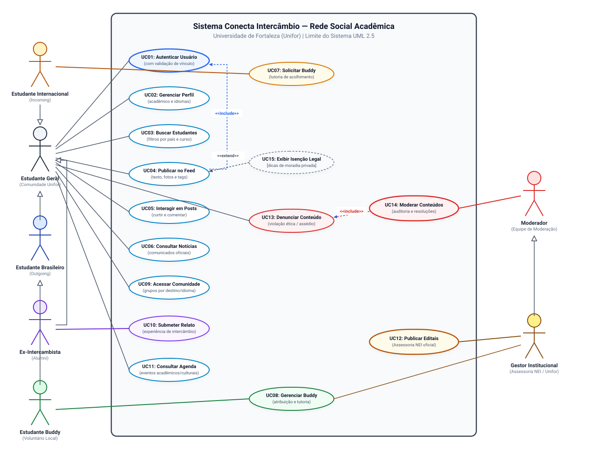
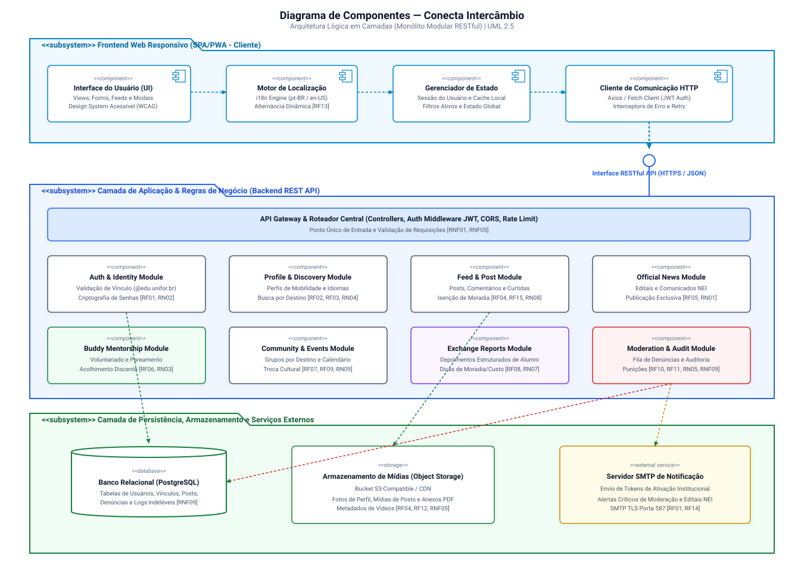
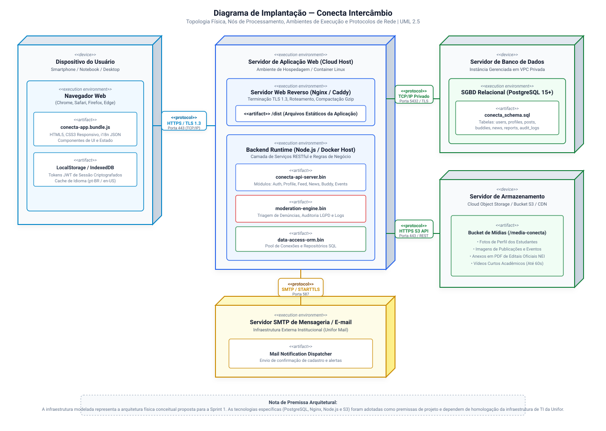

# Conecta Intercâmbio — Rede Social Acadêmica

> **Repositório Oficial de Engenharia de Requisitos e Modelagem de Software**  
> **Universidade de Fortaleza (Unifor)** | Centro de Ciências Tecnológicas (CCT)  
> **Disciplina:** Requisitos e Modelagem de Sistemas  
> **Avaliação:** Primeira Avaliação (P1) — Sprint 1 (Milestone M1) | Período: 20/10/2026 a 02/11/2026  
> **Eixo Temático de Extensão:** Internacionalização Universitária  
> **Docente Avaliador:** Prof. Marcelo Bezerra ([@marcelobezerra-dotcom](https://github.com/marcelobezerra-dotcom))  

---

## 1. Visão Geral do Projeto

O **Conecta Intercâmbio** é uma plataforma digital colaborativa desenvolvida para aproximar e integrar estudantes brasileiros (*outgoing*), estudantes estrangeiros em mobilidade na Unifor (*incoming*), ex-intercambistas (*alumni*) e a equipe da **Assessoria de Relações Internacionais / Núcleo de Internacionalização (NEI)** da Universidade de Fortaleza.

A solução investiga e mitiga gargalos clássicos da mobilidade acadêmica: a dispersão de comunicados e editais oficiais, as dificuldades de adaptação e acolhimento cultural dos discentes internacionais, o subaproveitamento das vivências práticas acumuladas por quem já viajou e os riscos de desinformação em negociações informais de moradia estudantil.

Diferenciando-se de redes sociais comerciais e genéricas (como Instagram ou WhatsApp), o Conecta Intercâmbio consolida um ambiente acadêmico estruturado, moderado, pautado na verificação de vínculo institucional, em conformidade com a LGPD e articulado a iniciativas formativas como o **Programa de Buddy** (apadrinhamento solidário) e o repositório perene de relatos de intercâmbio.

---

## 2. Status do Repositório e da Sprint 1 (P1)

- **Repositório GitHub:** `[INSERIR_LINK_DO_REPOSITORIO_GITHUB]` *(Ex: https://github.com/usuario/conecta-intercambio)*
- **Adição do Avaliador (`marcelobezerra-dotcom`):** ⚠️ **Pendente de Confirmação Manual** (Consulte instruções em [docs/pendencias-entrega.md](docs/pendencias-entrega.md)).
- **Ciclo Epistemológico:** Modelagem conceitual e especificação de requisitos concluídas; instrumentos de pesquisa de campo estruturados; entrevistas reais em fase de agendamento/coleta.

---

## 3. Estrutura de Diretórios do Repositório

```text
conecta-intercambio/
├── README.md                      # Documento principal de apresentação do repositório
├── docs/                          # Documentação completa de Engenharia de Requisitos
│   ├── documento-de-visao.md      # Visão de produto, contexto, escopo MVP e restrições
│   ├── stakeholders.md            # Mapeamento detalhado e matriz Poder x Interesse
│   ├── roteiro-de-entrevistas.md  # Roteiros semiestruturados abertos para 3 perfis
│   ├── resultados-de-entrevistas.md # Fichas de coleta, hipóteses de trabalho e evidências
│   ├── requisitos.md              # Requisitos Funcionais (RF) e Não Funcionais (RNF)
│   ├── regras-de-negocio.md       # Catálogo de Regras de Negócio e diretrizes éticas
│   ├── backlog.md                 # Product Backlog em Épicos, User Stories e MoSCoW
│   ├── rastreabilidade.md         # Matriz de Rastreabilidade Bidirecional (Forward/Backward)
│   ├── glossario.md               # Vocabulário padrão de domínio e engenharia de software
│   └── pendencias-entrega.md      # Procedimentos para adição do avaliador e checklist AVA
└── uml/                           # Modelos visuais em notação UML 2.5 padronizada
    ├── casos-de-uso.drawio        # Arquivo-fonte editável do Diagrama de Casos de Uso
    ├── casos-de-uso.svg           # Exportação vetorial do Diagrama de Casos de Uso
    ├── componentes.drawio         # Arquivo-fonte editável do Diagrama de Componentes
    ├── componentes.svg            # Exportação vetorial do Diagrama de Componentes
    ├── implantacao.drawio         # Arquivo-fonte editável do Diagrama de Implantação
    └── implantacao.svg            # Exportação vetorial do Diagrama de Implantação
```

---

## 4. Índice de Entregáveis Obrigatórios da Avaliação P1

A tabela a seguir consolida os entregáveis da disciplina, seus arquivos correspondentes e seus respectivos links relativos:

| Entregável Obrigatório | Arquivo Principal | Formato / Tipo | Descrição Sintética |
| :--- | :--- | :---: | :--- |
| **1. Documento de Visão** | [docs/documento-de-visao.md](docs/documento-de-visao.md) | Markdown | Problema investigado, justificativa, MVP, restrições e premissas. |
| **2. Identificação de Stakeholders** | [docs/stakeholders.md](docs/stakeholders.md) | Markdown | 10 perfis de stakeholders, matriz Mendelow e estratégias de engajamento. |
| **3. Roteiro de Entrevistas** | [docs/roteiro-de-entrevistas.md](docs/roteiro-de-entrevistas.md) | Markdown | Protocolo metodológico neutro para estudantes e gestores do NEI. |
| **4. Resultados de Entrevistas** | [docs/resultados-de-entrevistas.md](docs/resultados-de-entrevistas.md) | Markdown | Fichas de registro preparadas, hipóteses preliminares e integridade acadêmica. |
| **5. Requisitos de Software** | [docs/requisitos.md](docs/requisitos.md) | Markdown | 15 Requisitos Funcionais (RF) e 10 Não Funcionais (RNF) com critérios verificáveis. |
| **6. Regras de Negócio** | [docs/regras-de-negocio.md](docs/regras-de-negocio.md) | Markdown | 10 Regras de Negócio (RN) cobrindo moderação, privacidade, moradia e vínculo. |
| **7. Backlog Priorizado** | [docs/backlog.md](docs/backlog.md) | Markdown | 14 User Stories no MVP divididas em 6 Épicos (MoSCoW e Story Points). |
| **8. Rastreabilidade e Glossário** | [docs/rastreabilidade.md](docs/rastreabilidade.md) <br> [docs/glossario.md](docs/glossario.md) | Markdown | Matriz bidirecional completa e vocabulário técnico padronizado. |
| **9. Diagrama de Casos de Uso** | [uml/casos-de-uso.drawio](uml/casos-de-uso.drawio) <br> [uml/casos-de-uso.svg](uml/casos-de-uso.svg) | Draw.io / SVG | Atores, limite do sistema, casos de uso, `<<include>>` e `<<extend>>`. |
| **10. Diagrama de Componentes** | [uml/componentes.drawio](uml/componentes.drawio) <br> [uml/componentes.svg](uml/componentes.svg) | Draw.io / SVG | Arquitetura em camadas (Frontend SPA, Backend REST API, DB, S3 e SMTP). |
| **11. Diagrama de Implantação** | [uml/implantacao.drawio](uml/implantacao.drawio) <br> [uml/implantacao.svg](uml/implantacao.svg) | Draw.io / SVG | Topologia de nós físicos e lógicos, artefatos e protocolos de comunicação. |
| **12. Pendências e Evidências** | [docs/pendencias-entrega.md](docs/pendencias-entrega.md) | Markdown | Procedimento para convite de `marcelobezerra-dotcom` e checklist AVA. |

---

## 5. Visualização Rápida dos Diagramas UML

### A. Diagrama de Casos de Uso (UML 2.5)
Modela o limite do sistema, os atores da comunidade acadêmica e de governança, e as interações fundamentais da plataforma:



---

### B. Diagrama de Componentes (UML 2.5)
Modela a arquitetura lógica modular desacoplada em três subsistemas estruturais:



---

### C. Diagrama de Implantação (UML 2.5)
Modela a topologia física conceitual de hardware, nós de execução e protocolos de comunicação:



---

## 6. Ferramentas Utilizadas e Instruções de Edição

- **Modelagem e Especificação de Requisitos:** Markdown compatível com GitHub Flavored Markdown (GFM), Mermaid e padrões ISO/IEC/IEEE 29148.
- **Modelagem UML:** Draw.io / Diagrams.net (padrão XML nativo em arquivos `.drawio`) e renderização vetorial em SVG (`.svg`).
- **Como Visualizar e Editar os Diagramas:**
  1. *No Visual Studio Code / Antigravity IDE:* Instale a extensão **Draw.io Integration** (autor: *Henning Dieterichs*) para abrir e editar os arquivos `.drawio` com interface gráfica nativa.
  2. *Via Navegador Web:* Acesse [app.diagrams.net](https://app.diagrams.net), clique em *Abrir diagrama existente* e selecione o arquivo correspondente na pasta `uml/`.
  3. *Visualização Direta:* Os arquivos com extensão `.svg` abrem diretamente em qualquer navegador moderno ou visualizador de imagens do sistema operacional.

---

## 7. Próximos Passos (Transição para a Sprint 2 / P2)

1. **Execução das Entrevistas de Campo:** Aplicação dos roteiros semiestruturados com estudantes internacionais e brasileiros no campus da Unifor.
2. **Reunião de Alinhamento com a Assessoria NEI:** Validação formal das regras de negócio de comunicados oficiais (RN01) e termos de isenção de moradia (RN08).
3. **Prototipação de Baixa e Alta Fidelidade:** Elaboração de wireframes navegáveis baseados nos fluxos dos casos de uso modelados.
4. **Refinamento do Modelo de Dados:** Criação do Diagrama Entidade-Relacionamento (DER) e modelagem de classes de domínio.
