# Conecta Intercâmbio - Rede Social Acadêmica

> **Repositório Oficial de Engenharia de Requisitos e Modelagem de Software**  
> **Universidade de Fortaleza (Unifor)** | Centro de Ciências Tecnológicas (CCT)  
> **Disciplina:** Requisitos e Modelagem de Sistemas  
> **Avaliação atual:** Trabalho P2 - Sprint 2 (Milestone M2) | Período: 03/11/2026 a 23/11/2026 (P1: Sprint 1, 20/10 a 02/11/2026)  
> **Eixo Temático de Extensão:** Internacionalização Universitária  
> **Docente Avaliador:** Prof. Marcelo Bezerra ([@marcelobezerra-dotcom](https://github.com/marcelobezerra-dotcom))  

---

## Pitch final (P3, 01/12/2026)

| Item | Link |
| :--- | :--- |
| **Slides em PDF** | [`pitch/pitch-conecta-intercambio.pdf`](pitch/pitch-conecta-intercambio.pdf) (fonte: [`pitch/pitch.html`](pitch/pitch.html), no modelo da disciplina) |
| Roteiro de fala (8 a 10 min) | [`pitch/roteiro-pitch.md`](pitch/roteiro-pitch.md) |
| Sprint 3 (milestone M3) | Formulário de relato ([#28](https://github.com/Nikolasvianna-hub/conecta-intercambio/issues/28)), contraste automático ([#29](https://github.com/Nikolasvianna-hub/conecta-intercambio/issues/29)), pitch ([#31](https://github.com/Nikolasvianna-hub/conecta-intercambio/issues/31)); validação com o NEI segue aberta ([#27](https://github.com/Nikolasvianna-hub/conecta-intercambio/issues/27)) |

---

## Entrega P2 (links para o AVA)

| Item | Link |
| :--- | :--- |
| **Protótipo navegável** | https://nikolasvianna-hub.github.io/conecta-intercambio/ |
| **Repositório GitHub** | https://github.com/Nikolasvianna-hub/conecta-intercambio |
| SRS versionado (IEEE 830, v1.1) | [`docs/srs.md`](docs/srs.md) |
| Revisão de consistência UML × requisitos | [`docs/revisao-de-consistencia.md`](docs/revisao-de-consistencia.md) |
| Wireframes, roteiro de demonstração e prints | [`docs/prototipo.md`](docs/prototipo.md) · [`docs/evidencias/prototipo/`](docs/evidencias/prototipo/) |
| Diagramas UML atualizados | [`uml/`](uml/) — `casos-de-uso-v2`, `componentes-v2`, `implantacao-v2` (`.drawio` + `.svg`) |
| Issues fechadas por sprint | [M1 — Sprint 1](https://github.com/Nikolasvianna-hub/conecta-intercambio/issues?q=milestone%3A%22M1+%E2%80%94+Sprint+1+%28P1%29%22) · [M2 — Sprint 2](https://github.com/Nikolasvianna-hub/conecta-intercambio/issues?q=milestone%3A%22M2+%E2%80%94+Sprint+2+%28P2%29%22) · [M3 — Sprint 3](https://github.com/Nikolasvianna-hub/conecta-intercambio/issues?q=milestone%3A%22M3+%E2%80%94+Sprint+3%22) |

---

## Equipe

| Integrante | Matrícula | GitHub |
| :--- | :---: | :--- |
| Nikolas Vianna de Carvalho | 2623878 | [@Nikolasvianna-hub](https://github.com/Nikolasvianna-hub) |
| Arthur Maia Roberto | 2310641 | [@arthurmaiaz](https://github.com/arthurmaiaz) |
| Bruno Vasconcelos Rocha | 2612659 | [@brunovasr](https://github.com/brunovasr) |

---

## 1. Visão Geral do Projeto

O **Conecta Intercâmbio** é uma plataforma digital colaborativa desenvolvida para aproximar e integrar estudantes brasileiros (*outgoing*), estudantes estrangeiros em mobilidade na Unifor (*incoming*), ex-intercambistas (*alumni*) e a equipe da **Assessoria de Relações Internacionais / Núcleo de Internacionalização (NEI)** da Universidade de Fortaleza.

A solução investiga e mitiga gargalos clássicos da mobilidade acadêmica: a dispersão de comunicados e editais oficiais, as dificuldades de adaptação e acolhimento cultural dos discentes internacionais, o subaproveitamento das vivências práticas acumuladas por quem já viajou e os riscos de desinformação em negociações informais de moradia estudantil.

Diferenciando-se de redes sociais comerciais e genéricas (como Instagram ou WhatsApp), o Conecta Intercâmbio consolida um ambiente acadêmico estruturado, moderado, pautado na verificação de vínculo institucional, em conformidade com a LGPD e articulado a iniciativas formativas como o **Programa de Buddy** (apadrinhamento solidário) e o repositório perene de relatos de intercâmbio.

---

## 2. Status do Repositório e da Sprint 1 (P1)

- **Repositório GitHub:** `https://github.com/Nikolasvianna-hub/conecta-intercambio.git`
- **Adição do Avaliador (`marcelobezerra-dotcom`):** ✅ **Convite enviado em 02/11/2026** (evidência em [docs/evidencias/convite-marcelobezerra-dotcom.png](docs/evidencias/convite-marcelobezerra-dotcom.png)).
- **Ciclo Epistemológico:** Modelagem conceitual e especificação de requisitos concluídas; roteiros de entrevista estruturados; 6 estudantes entrevistados e consolidados; entrevista com a Assessoria NEI pendente.

---

## 3. Estrutura de Diretórios do Repositório

```text
conecta-intercambio/
├── README.md                      # Documento principal de apresentação do repositório
├── docs/                          # Documentação completa de Engenharia de Requisitos
│   ├── documento-de-visao.md      # Visão de produto, contexto, escopo MVP e restrições
│   ├── stakeholders.md            # Mapeamento detalhado e matriz Poder x Interesse
│   ├── roteiro-de-entrevistas.md  # Roteiros semiestruturados abertos para 3 perfis
│   ├── resultados-de-entrevistas.md # Situação da coleta, hipóteses e síntese da 1ª rodada
│   ├── fichas_de_registro_entrevista.pdf # Fichas preenchidas das entrevistas (Roteiros A, B e C)
│   ├── requisitos.md              # Requisitos Funcionais (RF) e Não Funcionais (RNF)
│   ├── regras-de-negocio.md       # Catálogo de Regras de Negócio e diretrizes éticas
│   ├── backlog.md                 # Product Backlog em Épicos, User Stories e MoSCoW (+ issues da Sprint 2)
│   ├── srs.md                     # SRS IEEE 830 com casos de uso detalhados (P2)
│   ├── revisao-de-consistencia.md # Alinhamento UML × requisitos × protótipo (P2)
│   ├── prototipo.md               # Wireframes, roteiro de demonstração e prints (P2)
│   ├── rastreabilidade.md         # Matriz de Rastreabilidade Bidirecional (Forward/Backward)
│   ├── glossario.md               # Vocabulário padrão de domínio e engenharia de software
│   ├── pendencias-entrega.md      # Convite ao avaliador e checklist AVA
│   └── evidencias/                # Print do convite ao avaliador e prints do protótipo (prototipo/)
├── app/                           # Protótipo navegável (React + TypeScript + Vite)
└── uml/                           # Modelos visuais em notação UML 2.5 padronizada
    ├── casos-de-uso.drawio        # Arquivo-fonte editável do Diagrama de Casos de Uso
    ├── casos-de-uso.svg           # Exportação vetorial do Diagrama de Casos de Uso
    ├── componentes.drawio         # Arquivo-fonte editável do Diagrama de Componentes
    ├── componentes.svg            # Exportação vetorial do Diagrama de Componentes
    ├── implantacao.drawio         # Arquivo-fonte editável do Diagrama de Implantação
    ├── implantacao.svg            # Exportação vetorial do Diagrama de Implantação
    └── *-v2.drawio / *-v2.svg     # Diagramas atualizados na Sprint 2 (casos de uso, componentes, implantação)
```

---

## 4. Índice de Entregáveis Obrigatórios da Avaliação P1

A tabela a seguir consolida os entregáveis da disciplina, seus arquivos correspondentes e seus respectivos links relativos:

| Entregável Obrigatório | Arquivo Principal | Formato / Tipo | Descrição Sintética |
| :--- | :--- | :---: | :--- |
| **1. Documento de Visão** | [docs/documento-de-visao.md](docs/documento-de-visao.md) | Markdown | Problema investigado, justificativa, MVP, restrições e premissas. |
| **2. Identificação de Stakeholders** | [docs/stakeholders.md](docs/stakeholders.md) | Markdown | 10 perfis de stakeholders, matriz Mendelow e estratégias de engajamento. |
| **3. Roteiro de Entrevistas** | [docs/roteiro-de-entrevistas.md](docs/roteiro-de-entrevistas.md) | Markdown | Protocolo metodológico neutro para estudantes e gestores do NEI. |
| **4. Resultados de Entrevistas** | [docs/resultados-de-entrevistas.md](docs/resultados-de-entrevistas.md) <br> [docs/fichas_de_registro_entrevista.pdf](docs/fichas_de_registro_entrevista.pdf) | Markdown / PDF | 8 fichas de registro, síntese por tema de 6 entrevistados, decisões de escopo e limitações. |
| **5. Requisitos de Software** | [docs/requisitos.md](docs/requisitos.md) | Markdown | 16 Requisitos Funcionais (RF) e 10 Não Funcionais (RNF), refinados pelas entrevistas. |
| **6. Regras de Negócio** | [docs/regras-de-negocio.md](docs/regras-de-negocio.md) | Markdown | 10 Regras de Negócio (RN) cobrindo moderação, privacidade, moradia e vínculo. |
| **7. Backlog Priorizado** | [docs/backlog.md](docs/backlog.md) | Markdown | 15 User Stories da Sprint 1 em 6 Épicos (49 SP Must + 26 SP Should), mais 6 itens futuros. |
| **8. Rastreabilidade e Glossário** | [docs/rastreabilidade.md](docs/rastreabilidade.md) <br> [docs/glossario.md](docs/glossario.md) | Markdown | Matriz bidirecional completa e vocabulário técnico padronizado. |
| **9. Diagrama de Casos de Uso** | [uml/casos-de-uso.drawio](uml/casos-de-uso.drawio) <br> [uml/casos-de-uso.svg](uml/casos-de-uso.svg) | Draw.io / SVG | Atores, limite do sistema, casos de uso, `<<include>>` e `<<extend>>`. |
| **10. Diagrama de Componentes** | [uml/componentes.drawio](uml/componentes.drawio) <br> [uml/componentes.svg](uml/componentes.svg) | Draw.io / SVG | Arquitetura em camadas (Frontend SPA, Backend REST API, DB, S3 e SMTP). |
| **11. Diagrama de Implantação** | [uml/implantacao.drawio](uml/implantacao.drawio) <br> [uml/implantacao.svg](uml/implantacao.svg) | Draw.io / SVG | Topologia de nós físicos e lógicos, artefatos e protocolos de comunicação. |
| **12. Pendências e Evidências** | [docs/pendencias-entrega.md](docs/pendencias-entrega.md) <br> [docs/evidencias/](docs/evidencias/convite-marcelobezerra-dotcom.png) | Markdown / PNG | Registro do convite a `marcelobezerra-dotcom` e checklist AVA. |

---

## 5. Visualização Rápida dos Diagramas UML

### A. Diagrama de Casos de Uso (UML 2.5)
Modela o limite do sistema, os atores da comunidade acadêmica e de governança, e as interações fundamentais da plataforma:

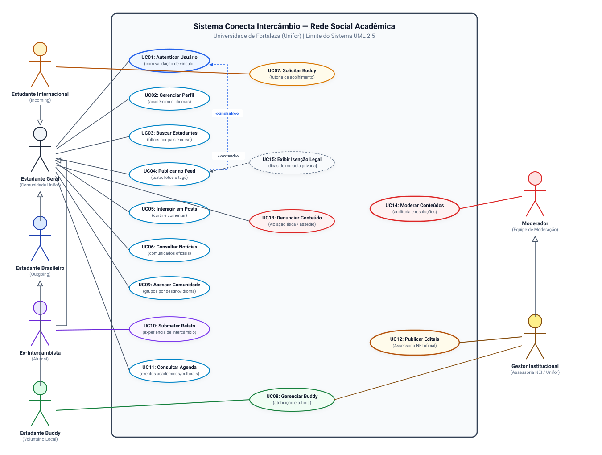

---

### B. Diagrama de Componentes (UML 2.5)
Modela a arquitetura lógica modular desacoplada em três subsistemas estruturais:

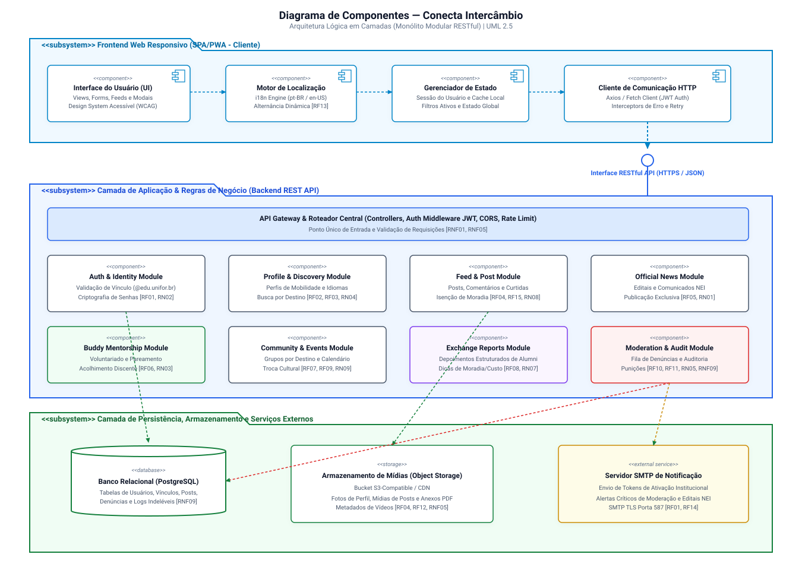

---

### C. Diagrama de Implantação (UML 2.5)
Modela a topologia física conceitual de hardware, nós de execução e protocolos de comunicação:

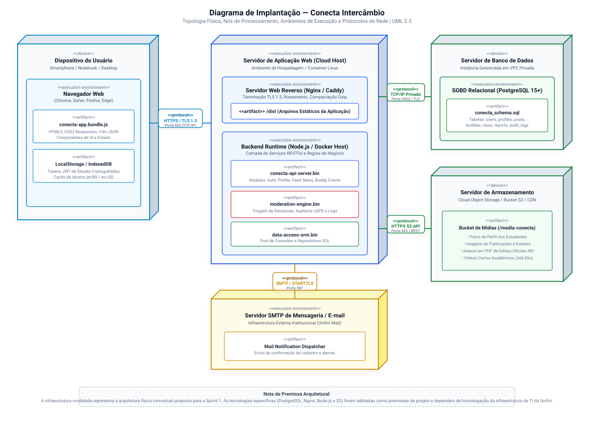

---

## 6. Ferramentas Utilizadas e Instruções de Edição

- **Modelagem e Especificação de Requisitos:** Markdown compatível com GitHub Flavored Markdown (GFM), Mermaid e padrões ISO/IEC/IEEE 29148.
- **Modelagem UML:** Draw.io / Diagrams.net (padrão XML nativo em arquivos `.drawio`) e renderização vetorial em SVG (`.svg`).
- **Como Visualizar e Editar os Diagramas:**
  1. *No Visual Studio Code:* Instale a extensão **Draw.io Integration** (autor: *Henning Dieterichs*) para abrir e editar os arquivos `.drawio` com interface gráfica nativa.
  2. *Via Navegador Web:* Acesse [app.diagrams.net](https://app.diagrams.net), clique em *Abrir diagrama existente* e selecione o arquivo correspondente na pasta `uml/`.
  3. *Visualização Direta:* Os arquivos com extensão `.svg` abrem diretamente em qualquer navegador moderno ou visualizador de imagens do sistema operacional.

---

## 7. Próximos Passos (Transição para a Sprint 2 / P2)

1. **Ampliação das Entrevistas de Campo:** Aplicação dos roteiros com ex-intercambistas e estudantes internacionais, ainda ausentes da amostra.
2. **Reunião de Alinhamento com a Assessoria NEI:** Validação formal das regras de negócio de comunicados oficiais (RN01) e termos de isenção de moradia (RN08).
3. **Prototipação de Baixa e Alta Fidelidade:** Elaboração de wireframes navegáveis baseados nos fluxos dos casos de uso modelados.
4. **Refinamento do Modelo de Dados:** Criação do Diagrama Entidade-Relacionamento (DER) e modelagem de classes de domínio.

---

## 8. Sprint 2 (P2, Milestone M2: 03/11 a 23/11/2026) — concluída

| Entregável P2 | Arquivo |
| :--- | :--- |
| **SRS (IEEE 830) com casos de uso** — introdução, descrição geral e requisitos detalhados | [`docs/srs.md`](docs/srs.md) (histórico de versões 0.1 → 1.1) |
| **Revisão de consistência UML × requisitos** | [`docs/revisao-de-consistencia.md`](docs/revisao-de-consistencia.md) |
| **Wireframes + protótipo navegável** | [`docs/prototipo.md`](docs/prototipo.md) · código em [`app/`](app) · [protótipo online](https://nikolasvianna-hub.github.io/conecta-intercambio/) |
| **UML atualizada** | [`casos-de-uso-v2`](uml/casos-de-uso-v2.drawio) (UC16–UC23) · [`componentes-v2`](uml/componentes-v2.drawio) · [`implantacao-v2`](uml/implantacao-v2.drawio) (canal WSS + Pub/Sub) |
| Requisitos novos | RF17–RF23, RNF11–RNF12 em [`docs/requisitos.md`](docs/requisitos.md) · RN11–RN14 em [`docs/regras-de-negocio.md`](docs/regras-de-negocio.md) |
| Backlog e issues da Sprint 2 | [`docs/backlog.md` §6](docs/backlog.md) · [milestone M2](https://github.com/Nikolasvianna-hub/conecta-intercambio/issues?q=milestone%3A%22M2+%E2%80%94+Sprint+2+%28P2%29%22) |

**Protótipo online:** https://nikolasvianna-hub.github.io/conecta-intercambio/ (publicado pelo workflow `.github/workflows/deploy-pages.yml`).

### Navegação do app (5 abas, identidade Unifor Mobile)
`🔍 Explorar` (fórum e guia da cidade) · `💬 Conversas` (estilo WhatsApp, com busca de perfis) · `🎬 Unifor` (jornal e reels da universidade) · `☰ Menu` (idioma, tema claro/noturno/personalizado, LGPD) · `👤 Perfil` (com notícias do meu curso)

| Unifor | Explorar | Conversas | Privacidade e LGPD | Perfil |
| :---: | :---: | :---: | :---: | :---: |
| 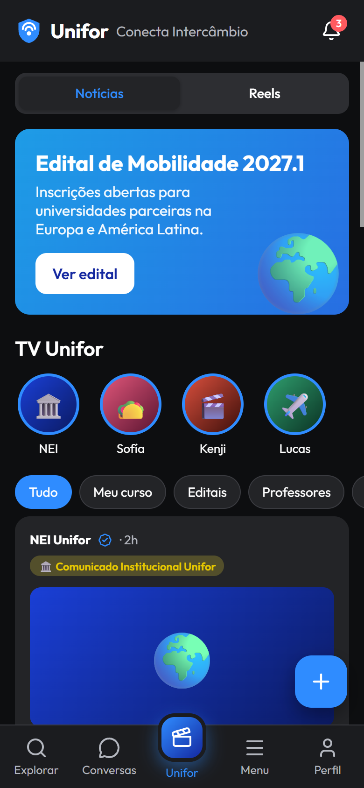 | 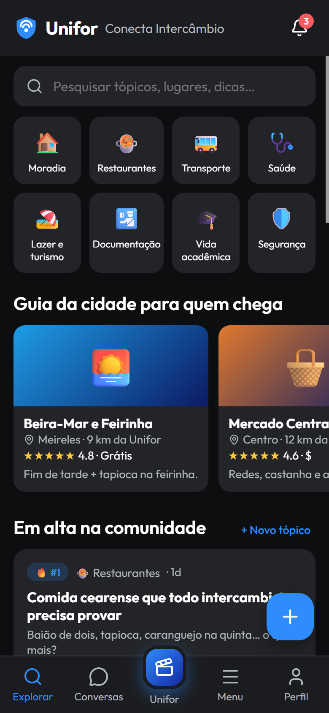 | 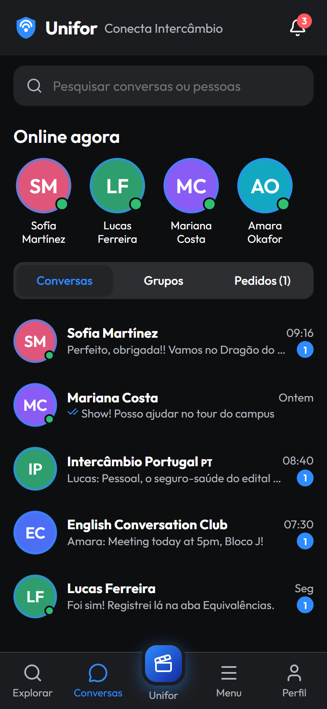 | 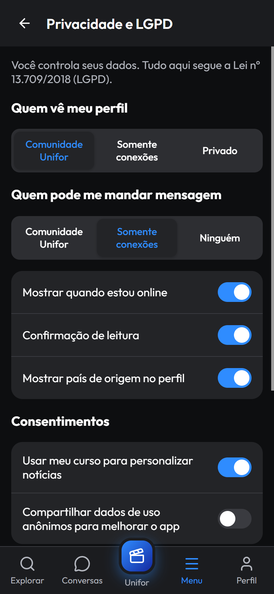 | 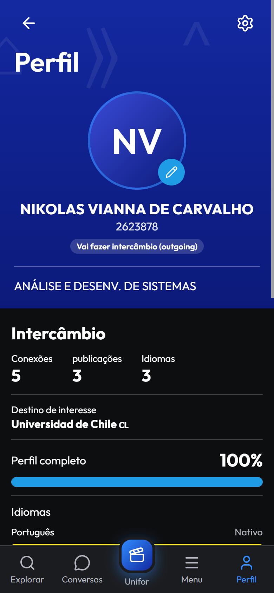 |

### Diagramas da Sprint 2
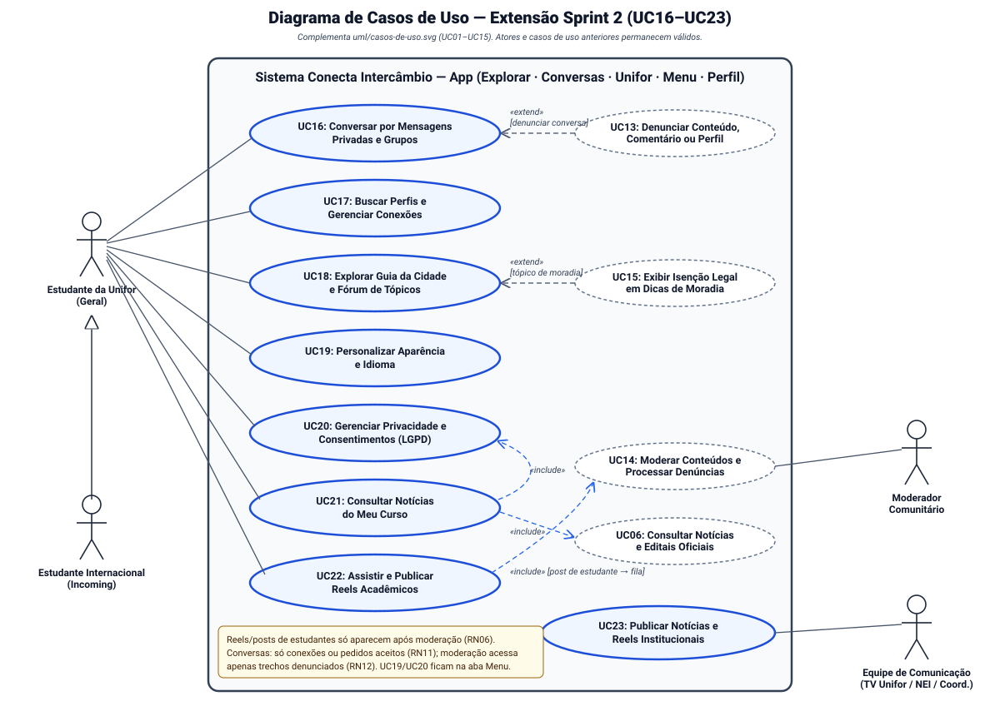
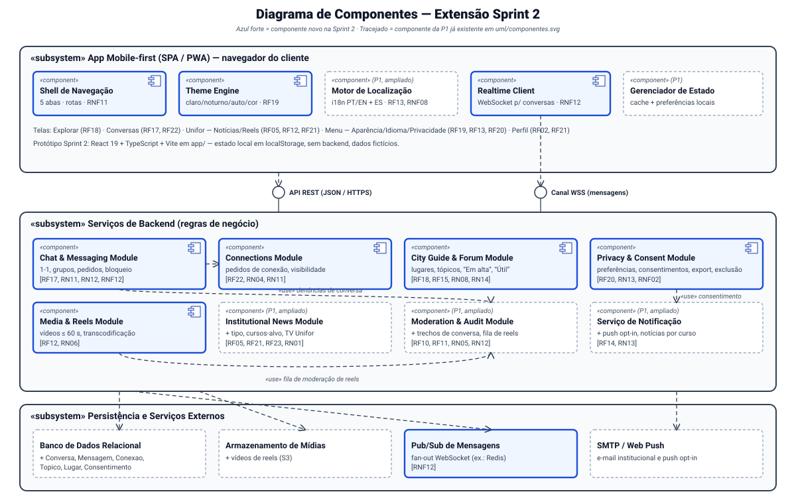
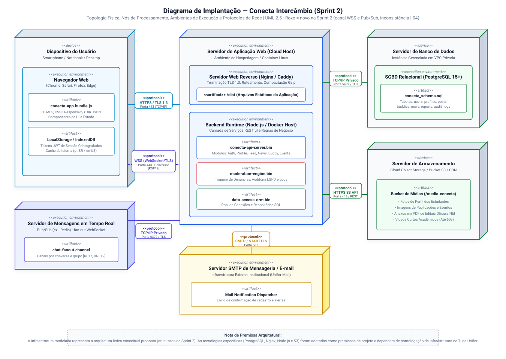

### Sprint 3 (milestone M3, 24/11 a 30/11/2026)
- ✅ [#28](https://github.com/Nikolasvianna-hub/conecta-intercambio/issues/28) Formulário de envio de relato no protótipo (I-08).
- ✅ [#29](https://github.com/Nikolasvianna-hub/conecta-intercambio/issues/29) Contraste automático e aviso na cor de destaque (I-11).
- ✅ [#31](https://github.com/Nikolasvianna-hub/conecta-intercambio/issues/31) Pitch final (slides em PDF e roteiro).
- ⏳ [#27](https://github.com/Nikolasvianna-hub/conecta-intercambio/issues/27) Validar RN11–RN14 com o NEI e contato com a TV Unifor (ainda não realizada).
