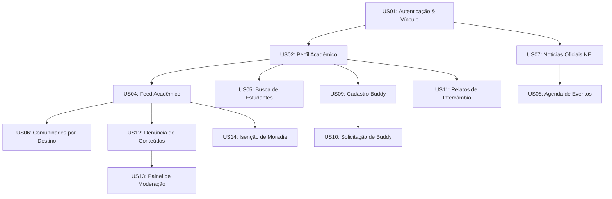

# Backlog Priorizado do Produto — Conecta Intercâmbio

Este documento apresenta o **Product Backlog** do projeto **Conecta Intercâmbio — Rede Social Acadêmica**, estruturado em Épicos e Histórias de Usuário (*User Stories*), priorizado segundo a metodologia **MoSCoW** para o ciclo da **Sprint 1 (Milestone M1 / Avaliação P1)** da disciplina **Requisitos e Modelagem de Sistemas** da Universidade de Fortaleza (Unifor).

---

## 1. Metodologia de Priorização e Estimativa

### Categorização MoSCoW:
- **Must Have (Indispensável para o MVP):** Funcionalidades sem as quais a plataforma perde sua razão de ser ou inviabiliza a demonstração conceitual da Sprint 1 (autenticação segura, perfis de mobilidade, feed acadêmico básico, notícias oficiais, relatos de ex-intercambistas, moderação de denúncias e interface multilíngue).
- **Should Have (Importante para o Ciclo):** Funcionalidades de alto valor agregado que complementam a experiência do usuário, programadas para consolidação na sequência imediata do MVP (módulo básico de solicitação de Buddy, agenda de eventos, comunidades temáticas e central de notificações).
- **Could Have (Desejável / Hipótese em Análise):** Ideias promissoras de engajamento que serão implementadas somente se houver viabilidade técnica e sobra de capacidade na equipe (ex.: reprodutor vertical de vídeos curtos acadêmicos).
- **Won't Have Now (Fora do Escopo da P1 / Versões Futuras):** Funcionalidades com alta complexidade arquitetural, custos de infraestrutura proibitivos ou riscos regulatórios prematuros (mensagens privadas instantâneas via WebSocket ponta a ponta, matching automatizado por Inteligência Artificial, tradução automática por IA generativa e intermediação financeira de moradias).

### Estimativa Relativa (Story Points):
A complexidade e o esforço de cada história são mensurados utilizando a sequência de Fibonacci: **1, 2, 3, 5, 8 e 13 Story Points (SP)**, considerando esforço de modelagem, incerteza de regras e complexidade de interface.

---

## 2. Visão Geral dos Épicos de Produto

```
+-----------------------------------------------------------------------------------------+
|                                    EPIC OVERVIEW MAP                                    |
+-----------------------------------------------------------------------------------------+
| [EP01] Gestão de Identidade, Autenticação e Perfis Acadêmicos (13 SP)                   |
| [EP02] Feed Acadêmico, Comunidades e Interações Sociais (16 SP)                         |
| [EP03] Comunicação Oficial, Notícias e Editais de Mobilidade (8 SP)                     |
| [EP04] Acolhimento, Mentoria e Conexão por Buddy (13 SP)                                |
| [EP05] Repositório de Relatos e Vivências de Intercâmbio (8 SP)                          |
| [EP06] Governança, Moderação Ética e Segurança Institucional (13 SP)                    |
| [EP07] Funcionalidades Avançadas e Horizontes Futuros (Won't Have Now) (34 SP)         |
+-----------------------------------------------------------------------------------------+
 Total do MVP Essencial (Must Have): 42 Story Points
 Total da Sprint 1 / P1 (Must + Should): 71 Story Points
```

---

## 3. Detalhamento das Histórias de Usuário (User Stories)

### Épico 1: Gestão de Identidade, Autenticação e Perfis Acadêmicos (EP01)

#### US01 — Cadastro e Autenticação com Validação de Vínculo
- **ID:** `US01` | **Épico:** `EP01` | **Prioridade:** **Must have** | **Estimativa:** **5 SP**
- **História de Usuário:**  
  *Como* estudante ou colaborador da Unifor,  
  *quero* me cadastrar e autenticar na plataforma utilizando meu e-mail institucional ou código de intercâmbio,  
  *para que* eu possa interagir em um ambiente acadêmico confiável e restrito à comunidade universitária.
- **Justificativa:** A autenticidade da comunidade é a base da segurança da informação e prevenção de assédio e contas fraudulentas.
- **Critérios de Aceitação:**  
  - *Cenário 1:* Discente com e-mail `@edu.unifor.br` preenche cadastro e recebe e-mail de ativação com link de validação.
  - *Cenário 2:* Estudante internacional com código de aceite temporário tem o vínculo validado pelo administrador antes da liberação total.
  - *Cenário 3:* Tentativas de cadastro com e-mails públicos comerciais (ex.: `@gmail.com`) sem código de exceção de intercâmbio são rejeitadas com mensagem explicativa.
- **Dependências:** Nenhuma.
- **Status de Validação:** **Validado pelo Escopo da P1** (Vinculado a RF01, RN02, RNF01).

---

#### US02 — Configuração de Perfil Intercultural e Histórico de Mobilidade
- **ID:** `US02` | **Épico:** `EP01` | **Prioridade:** **Must have** | **Estimativa:** **5 SP**
- **História de Usuário:**  
  *Como* usuário cadastrado (estudante local, intercambista ou egresso),  
  *quero* personalizar meu perfil com curso, país de origem/destino, idiomas falados, breve biografia e foto,  
  *para que* outros estudantes com interesses correlatos possam me identificar facilmente.
- **Justificativa:** O perfil é o cartão de visitas que subsidia a descoberta mútua e o entrosamento discente.
- **Critérios de Aceitação:**  
  - Usuário pode selecionar seu status (Intercambista *Incoming*, Aluno Local *Outgoing*, Ex-Intercambista, Buddy Voluntário).
  - O selo de vínculo oficial é exibido em destaque e não pode ser forjado pelo próprio discente.
  - Informações sensíveis de contato permanecem ocultas por padrão (RN04).
- **Dependências:** `US01`.
- **Status de Validação:** **Validado pelo Escopo da P1** (Vinculado a RF02, RN04, RNF02).

---

#### US03 — Seleção Dinâmica de Idioma da Interface (Português / Inglês)
- **ID:** `US03` | **Épico:** `EP01` | **Prioridade:** **Must have** | **Estimativa:** **3 SP**
- **História de Usuário:**  
  *Como* estudante estrangeiro recém-chegado que ainda não domina o português,  
  *quero* alternar a interface gráfica para o idioma inglês com um clique,  
  *para que* eu compreenda as opções de navegação e consiga utilizar a plataforma com autonomia.
- **Justificativa:** Reduzir a barreira de entrada e acolher com dignidade intercambistas não lusófonos.
- **Critérios de Aceitação:**  
  - Seletor de idioma acessível no cabeçalho em todas as páginas da plataforma.
  - Alternância imediata de todos os textos estáticos da interface sem recarregar a página.
  - Persistência da preferência de idioma no perfil do usuário ou sessão do navegador.
- **Dependências:** Nenhuma.
- **Status de Validação:** **Validado pelo Escopo da P1** (Vinculado a RF13, RNF08).

---

### Épico 2: Feed Acadêmico, Comunidades e Interações Sociais (EP02)

#### US04 — Publicação e Interação no Feed Acadêmico
- **ID:** `US04` | **Épico:** `EP02` | **Prioridade:** **Must have** | **Estimativa:** **5 SP**
- **História de Usuário:**  
  *Como* estudante internacional ou local,  
  *quero* publicar mensagens de texto e imagens no feed e interagir através de comentários e curtidas,  
  *para que* eu compartilhe momentos do intercâmbio, tire dúvidas da rotina e socialize com meus colegas.
- **Justificativa:** Mecanismo central de circulação comunitária e engajamento cotidiano da rede.
- **Critérios de Aceitação:**  
  - Postagem de até 1.000 caracteres e até 4 imagens em formatos padrão (JPG, PNG, WebP).
  - Listagem do feed em ordem cronológica decrescente.
  - Possibilidade de curtir e comentar postagens públicas de outros estudantes.
  - Opção do autor de excluir suas próprias publicações e comentários.
- **Dependências:** `US01`, `US02`.
- **Status de Validação:** **Validado pelo Escopo da P1** (Vinculado a RF04, RNF03).

---

#### US05 — Busca e Descoberta de Perfis por Destino e Idioma
- **ID:** `US05` | **Épico:** `EP02` | **Prioridade:** **Must have** | **Estimativa:** **5 SP**
- **História de Usuário:**  
  *Como* estudante brasileiro planejando intercâmbio,  
  *quero* filtrar perfis de estudantes por país de destino, curso e idioma,  
  *para que* eu encontre veteranos que já estudaram na universidade que pretendo me candidatar.
- **Justificativa:** Diminui o tempo de busca e conecta candidatos diretamente com a experiência de campo.
- **Critérios de Aceitação:**  
  - Barra de busca com filtros combinados (País, Curso, Idioma, Tipo de Vínculo).
  - Resultados paginados exibindo card resumido com foto, nome, curso e botão de conexão.
  - Respeito estrito aos parâmetros de privacidade configurados pelo usuário buscado.
- **Dependências:** `US02`.
- **Status de Validação:** **Validado pelo Escopo da P1** (Vinculado a RF03, RNF05).

---

#### US06 — Participação em Comunidades Temáticas por Destino
- **ID:** `US06` | **Épico:** `EP02` | **Prioridade:** **Should have** | **Estimativa:** **6 SP**
- **História de Usuário:**  
  *Como* intercambista ou candidato a intercâmbio,  
  *quero* ingressar em comunidades temáticas segmentadas (ex.: "Intercâmbio Portugal", "Tandem Idiomas"),  
  *para que* eu acompanhe discussões específicas do meu destino sem sobrecarregar o feed geral.
- **Justificativa:** Segmentação de conversas e facilidade de localização de tópicos de interesse específico.
- **Critérios de Aceitação:**  
  - Catálogo de comunidades públicas com contagem de membros ativos.
  - Ação de "Entrar no Grupo" com um clique e mural de postagens exclusivo da comunidade.
- **Dependências:** `US04`.
- **Status de Validação:** **Validado pelo Escopo da P1** (Vinculado a RF07).

---

### Épico 3: Comunicação Oficial, Notícias e Editais de Mobilidade (EP03)

#### US07 — Mural Oficial de Notícias e Editais da Assessoria NEI
- **ID:** `US07` | **Épico:** `EP03` | **Prioridade:** **Must have** | **Estimativa:** **5 SP**
- **História de Usuário:**  
  *Como* discente interessado em mobilidade acadêmica,  
  *quero* consultar uma seção dedicada de notícias e editais oficiais do NEI,  
  *para que* eu não perca prazos de bolsas, datas de inscrições e orientações regulatórias essenciais.
- **Justificativa:** Combater a dispersão de comunicados e centralizar a voz institucional da universidade.
- **Critérios de Aceitação:**  
  - Somente usuários com permissão `Gestor NEI` podem publicar ou editar no mural oficial (RN01).
  - Cada comunicado exibe data oficial, autor institucional, texto formatado e anexo PDF opcional.
  - Notícias oficiais exibem destaque visual claro para não serem confundidas com postagens comuns.
- **Dependências:** `US01`.
- **Status de Validação:** **Validado pelo Escopo da P1** (Vinculado a RF05, RN01).

---

#### US08 — Agenda de Eventos Acadêmicos e Culturais
- **ID:** `US08` | **Épico:** `EP03` | **Prioridade:** **Should have** | **Estimativa:** **3 SP**
- **História de Usuário:**  
  *Como* estudante internacional ou local,  
  *quero* visualizar o calendário de eventos e feiras de internacionalização da Unifor e marcar presença,  
  *para que* eu organize minha rotina acadêmica e participe ativamente das atividades do campus.
- **Justificativa:** Aumentar o comparecimento discente em workshops e atividades de integração cultural.
- **Critérios de Aceitação:**  
  - Exibição em formato de grade ou lista cronológica de eventos com local, data e organizador.
  - Botão "Tenho Interesse" atualizando contador de confirmações discentes.
- **Dependências:** `US07`.
- **Status de Validação:** **Validado pelo Escopo da P1** (Vinculado a RF09, RN09).

---

### Épico 4: Acolhimento, Mentoria e Conexão por Buddy (EP04)

#### US09 — Cadastro de Estudante Voluntário no Programa de Buddy
- **ID:** `US09` | **Épico:** `EP04` | **Prioridade:** **Should have** | **Estimativa:** **5 SP**
- **História de Usuário:**  
  *Como* estudante brasileiro veterano da Unifor,  
  *quero* me cadastrar como voluntário do Programa de Buddy indicando meus idiomas e áreas de interesse,  
  *para que* eu seja designado para apadrinhar e acolher estudantes estrangeiros recém-chegados.
- **Justificativa:** Base operacional para viabilizar o acolhimento humanizado discente.
- **Critérios de Aceitação:**  
  - O sistema valida os pré-requisitos de elegibilidade discente conforme RN03.
  - Termo de voluntariado e responsabilidade é exibido e requer aceite formal do aluno.
  - Perfil recebe a insígnia *"Candidato a Buddy"* até a homologação pela gestão.
- **Dependências:** `US01`, `US02`.
- **Status de Validação:** **Hipótese de Produto (Pendente de Validação Institucional)** (Vinculado a RF06, RN03).

---

#### US10 — Solicitação e Vinculação de Apadrinhamento por Buddy
- **ID:** `US10` | **Épico:** `EP04` | **Prioridade:** **Should have** | **Estimativa:** **8 SP**
- **História de Usuário:**  
  *Como* estudante internacional recém-admitido na Unifor,  
  *quero* solicitar a atribuição de um Buddy local,  
  *para que* eu receba orientações personalizadas sobre o campus, transporte e adaptação cultural em Fortaleza.
- **Justificativa:** Mitiga o isolamento inicial do intercambista e estabelece uma ponte de confiança imediata.
- **Critérios de Aceitação:**  
  - Intercambista clica em "Solicitar Buddy" e seleciona idiomas de preferência.
  - Sistema encaminha a solicitação ou apresenta voluntários elegíveis compatíveis para conexão mútua.
  - Ao ser confirmada a ligação, ambos recebem notificação e visualizam dados autorizados de contato.
- **Dependências:** `US09`.
- **Status de Validação:** **Hipótese de Produto (Pendente de Validação Institucional)** (Vinculado a RF06, RN03, RF14).

---

### Épico 5: Repositório de Relatos e Vivências de Intercâmbio (EP05)

#### US11 — Publicação e Consulta de Relatos Estruturados de Intercâmbio
- **ID:** `US11` | **Épico:** `EP05` | **Prioridade:** **Must have** | **Estimativa:** **8 SP**
- **História de Usuário:**  
  *Como* ex-intercambista da Unifor,  
  *quero* submeter um relato detalhado sobre a universidade e cidade estrangeira onde estudei,  
  *para que* futuros candidatos tenham um guia prático e autêntico para subsidiar seu planejamento.
- **Justificativa:** Construção de memória institucional viva e compartilhamento de inteligência prática discente.
- **Critérios de Aceitação:**  
  - Formulário estruturado com campos: Universidade Parceira, Cidade/País, Custo Estimado Mensal, Facilidade de Hospedagem (nota 1 a 5), Desafios Acadêmicos e Dicas de Ouro.
  - Relatos ficam disponíveis para consulta pública com busca por universidade parceira.
  - Exibição de aviso informando que relatos são opiniões pessoais de ex-alunos (RN07).
- **Dependências:** `US01`, `US02`.
- **Status de Validação:** **Validado pelo Escopo da P1** (Vinculado a RF08, RN07).

---

### Épico 6: Governança, Moderação Ética e Segurança Institucional (EP06)

#### US12 — Denúncia de Conteúdos, Comentários e Perfis
- **ID:** `US12` | **Épico:** `EP06` | **Prioridade:** **Must have** | **Estimativa:** **3 SP**
- **História de Usuário:**  
  *Como* membro da comunidade acadêmica,  
  *quero* denunciar publicações, comentários ou perfis que violem as normas éticas ou contenham ofensas,  
  *para que* a equipe de moderação tome as devidas providências protetivas.
- **Justificativa:** Participação coletiva na manutenção de um ambiente respeitoso, seguro e livre de abusos.
- **Critérios de Aceitação:**  
  - Botão de denúncia acessível no menu de opções de qualquer post ou comentário.
  - Formulário com motivos padronizados (Discurso de Ódio/Xenofobia, Desinformação, Fraude/Moradia, Conteúdo Impróprio).
  - Omissão da identidade do denunciante para o autor da postagem.
- **Dependências:** `US04`.
- **Status de Validação:** **Validado pelo Escopo da P1** (Vinculado a RF10, RN05).

---

#### US13 — Painel de Triagem e Resolução de Moderação
- **ID:** `US13` | **Épico:** `EP06` | **Prioridade:** **Must have** | **Estimativa:** **5 SP**
- **História de Usuário:**  
  *Como* moderador ou administrador institucional da plataforma,  
  *quero* acessar um painel com a fila de denúncias pendentes e tomar ações de rejeição, advertência ou remoção,  
  *para que* a convivência na plataforma se mantenha em estrito acordo com os valores universitários.
- **Justificativa:** Garantia de pronta resposta e governança ativa contra desvios de conduta.
- **Critérios de Aceitação:**  
  - Painel lista denúncias ordenadas por gravidade e quantidade de reportes.
  - Ação de exclusão exige justificativa registrada em log de auditoria indelével (RNF09).
  - Aplicação de regra de suspensão cautelar automática ao atingir limites de denúncias (RN05, RN10).
- **Dependências:** `US12`.
- **Status de Validação:** **Validado pelo Escopo da P1** (Vinculado a RF11, RN05, RN10, RNF09).

---

#### US14 — Termo Compulsório de Isenção em Dicas de Moradia
- **ID:** `US14` | **Épico:** `EP06` | **Prioridade:** **Must have** | **Estimativa:** **5 SP**
- **História de Usuário:**  
  *Como* gestor institucional e representante da Unifor,  
  *quero* que toda postagem referente a moradia ou hospedagem exiba aviso compulsório de isenção de responsabilidade,  
  *para que* a universidade não seja corresponsabilizada por litígios financeiros privados entre discentes e locadores.
- **Justificativa:** Blindagem jurídica institucional e proteção patrimonial dos estudantes.
- **Critérios de Aceitação:**  
  - Qualquer postagem marcada na categoria "Moradia" anexa banner institucional automático intransponível (RN08, RF15).
  - Bloqueio de campos de dados bancários diretos para inibir golpes financeiros.
- **Dependências:** `US04`.
- **Status de Validação:** **Validado pelo Escopo da P1** (Vinculado a RF15, RN08).

---

## 4. Épico 7: Funcionalidades Fora do Escopo da P1 / Horizontes Futuros (Won't Have Now)

As histórias a seguir foram concebidas durante as sessões de ideação e análise de requisitos, mas foram **deliberadamente postergadas para sprints subsequentes (P2/P3)** para preservar o foco acadêmico da P1 na modelagem conceitual rigorosa do MVP:

| ID | Épico | História de Usuário (Resumo) | Estimativa | Motivo da Exclusão do Escopo da P1 |
| :---: | :---: | :--- | :---: | :--- |
| **US15** | EP07 | *Feed Vertical de Vídeos Curtos (Reels/Shorts)* — Visualização e gravação de vídeos curtos de até 60s pelo aplicativo móvel. | 13 SP | **Alta Complexidade de Infraestrutura:** Exige pipeline de codificação de vídeo, streaming adaptativo (HLS), alto consumo de armazenamento em nuvem e moderação visual pesada. Mantido como hipótese Could Have técnica (RF12). |
| **US16** | EP07 | *Chat Privado de Mensagens em Tempo Real (1-to-1)* — Troca instantânea de mensagens diretas entre discentes via WebSockets. | 8 SP | **Risco de Segurança e Infraestrutura:** Exige gestão de conexões concorrentes persistentes, criptografia fim a fim e política complexa de moderação de assédio privado. Na P1, o contato é viabilizado por perfis e conexões institucionais. |
| **US17** | EP07 | *Algoritmo de Matching por Inteligência Artificial para o Buddy* — Pareamento automático de mentores discentes usando aprendizado de máquina. | 8 SP | **Desproporcionalidade Técnica Inicial:** O volume inicial de intercambistas no escopo da disciplina é atendido perfeitamente por regras determinísticas simples ou curadoria semiestruturada. |
| **US18** | EP07 | *Tradução Automática Dinâmica de Postagens por IA* — Tradução em tempo real de publicações discentes em múltiplos idiomas. | 5 SP | **Dependência e Custo de API Externa:** Dependência de chaves pagas de APIs de tradução comercial, incompatível com premissas de protótipo acadêmico autônomo na Sprint 1. |

---

## 5. Relação de Dependências Técnicas do Backlog da P1


