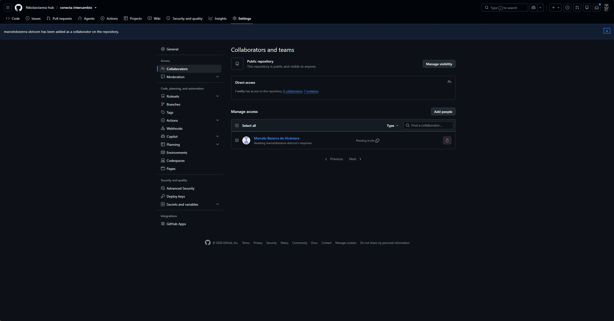

# Pendências de Entrega e Evidências de Acesso ao Repositório

Este documento consolida os itens administrativos e procedimentais pendentes para a submissão formal da **Avaliação P1 (Sprint 1 / Milestone M1)** da disciplina de **Requisitos e Modelagem de Sistemas** da Universidade de Fortaleza (Unifor).

---

## 1. Adição do Avaliador ao Repositório GitHub

> [!IMPORTANT]
> **Status Atual:** ✅ **CONVITE ENVIADO EM 02/11/2026 (aguardando aceite do avaliador)**
>
> A inclusão do professor/avaliador como colaborador do repositório é um requisito obrigatório para a avaliação no Ambiente Virtual de Aprendizagem (AVA / Unifor Online). Essa ação só pode ser feita pelo proprietário do repositório (conta `Nikolasvianna-hub`), em *Settings → Collaborators*.

### Informações do Avaliador
- **Usuário do GitHub a ser adicionado:** `marcelobezerra-dotcom`
- **Nível de acesso recomendado:** *Read* ou *Triage* (ou *Collaborator* conforme as orientações da disciplina).

### Instruções Passo a Passo para o Proprietário do Repositório:
1. Acesse o repositório do projeto no GitHub pelo navegador: `https://github.com/Nikolasvianna-hub/conecta-intercambio`.
2. Clique na aba superior **Settings** (Configurações do Repositório).
3. No menu lateral esquerdo, na seção *Access*, clique em **Collaborators** (ou *Collaborators and teams*).
4. Insira sua senha ou confirmação biométrica do GitHub caso seja solicitada.
5. Clique no botão verde **Add people**.
6. Digite exatamente o nome de usuário: `marcelobezerra-dotcom`.
7. Selecione o perfil oficial do avaliador e clique em **Add marcelobezerra-dotcom to this repository**.
8. Confirme o envio do convite. O status aparecerá inicialmente como *"Pending Invite"*.
9. Capture uma evidência visual (print de tela) nítida que mostre:
   - A URL da página de configurações;
   - O nome do repositório;
   - O usuário `marcelobezerra-dotcom` listado como colaborador convidado ou ativo;
   - A data e horário do sistema visíveis.
10. Salve a imagem comprobatória em `docs/evidencias/` e anexe-a também na submissão do AVA.

---

## 2. Registro da Evidência Comprobatória

| Campo | Registro / Evidência |
| :--- | :--- |
| **Link Oficial do Repositório GitHub** | https://github.com/Nikolasvianna-hub/conecta-intercambio |
| **Data do Envio do Convite** | 02/11/2026, por volta de 16:10 (horário de Fortaleza) |
| **Status do Convite** | Enviado (Pending Invite, aguardando aceite de `marcelobezerra-dotcom`) |
| **Arquivo de Captura de Tela (Print)** | [docs/evidencias/convite-marcelobezerra-dotcom.png](evidencias/convite-marcelobezerra-dotcom.png) |
| **Responsável pelo Envio no Grupo** | Nikolas Vianna de Carvalho, matrícula 2623878 (`Nikolasvianna-hub`, proprietário do repositório) |

---

## 3. Checklist de Entrega no AVA (Unifor Online)

Antes do fechamento do prazo estipulado (Sprint 1: 20/10/2026 a 02/11/2026), certifique-se de validar todos os itens da tabela:

- [x] Repositório GitHub público ou privado com acesso garantido ao usuário `marcelobezerra-dotcom`.
- [x] Link do repositório testado e acessível.
- [x] Evidência de acesso de `marcelobezerra-dotcom` anexada no campo de submissão do AVA ou pasta de evidências.
- [x] Todos os entregáveis obrigatórios presentes na branch principal (`main`):
  1. `docs/documento-de-visao.md`
  2. `docs/stakeholders.md`
  3. `docs/roteiro-de-entrevistas.md`
  4. `docs/resultados-de-entrevistas.md`
  5. `docs/requisitos.md`
  6. `docs/regras-de-negocio.md`
  7. `docs/backlog.md`
  8. `docs/rastreabilidade.md`
  9. Diagramas UML em `uml/`: Casos de Uso, Componentes e Implantação (.drawio e imagens exportadas).
- [x] `README.md` estruturado com links relativos funcionais direcionando para todos os artefatos.
- [x] Ausência de dados fictícios disfarçados de resultados empíricos reais (status de validação devidamente explícitos).
- [x] Fichas da 1ª rodada de entrevistas anexadas (`docs/fichas_de_registro_entrevista.pdf`) e consolidadas em `docs/resultados-de-entrevistas.md`.

