# Protótipo Navegável e Wireframes — Conecta Intercâmbio (Sprint 2)

> **Link do protótipo:** https://nikolasvianna-hub.github.io/conecta-intercambio/ (publicado no GitHub Pages; ver §5)
> **Código-fonte:** [`app/`](../app) — React 19 + TypeScript + Vite · dados fictícios · sem backend

## 1. Conceito de navegação
O ponto de partida foi o rascunho da equipe no quadro: um celular com quatro ícones na base (lupa, balão de conversa, engrenagem/menu e perfil) e um espaço livre no centro para a área de notícias e reels. A identidade visual segue o **Unifor Mobile** (tema escuro, cartões arredondados, azul Unifor, cabeçalho de perfil azul royal), com referências do AVA e do Unifor Online.

```
┌─────────────────────────────────┐
│ ⛨ Unifor  Conecta Intercâmbio 🔔│  ← barra superior (marca + notificações)
├─────────────────────────────────┤
│                                 │
│         conteúdo da aba         │
│                                 │
├─────────────────────────────────┤
│  🔍     💬    [🎬]     ☰     👤  │  ← 5 abas; “Unifor” no centro, em destaque
│Explorar Conversas Unifor Menu Perfil
└─────────────────────────────────┘
```

| Aba | Inspiração | O que tem |
| :--- | :--- | :--- |
| 🔍 **Explorar** | Fórum / guia de cidade | Busca, 8 categorias, guia de Fortaleza (distância até a Unifor), tópicos em alta, relatos, equivalências |
| 💬 **Conversas** | WhatsApp + Instagram | Online agora, Conversas / Grupos / Pedidos, busca de pessoas, conversa com ✓✓, denunciar, bloquear |
| 🎬 **Unifor** | Jornal + TikTok/Reels | Destaque de edital, faixa TV Unifor, filtros (Meu curso, Editais, Professores…), notícias oficiais, reels verticais |
| ☰ **Menu** | Menu do Unifor Mobile | Idioma, Aparência (claro/noturno/auto/cor), Privacidade e LGPD, Notificações, Buddy, Agenda, Moderação, FAQ |
| 👤 **Perfil** | Perfil do Unifor Mobile + LinkedIn | Cabeçalho azul, matrícula, curso, bloco “Intercâmbio”, idiomas, **Notícias do meu curso**, publicações |

## 2. Wireframes (baixa fidelidade)

### 2.1 Explorar
```
┌─────────────────────────────┐
│ [🔍 Pesquisar tópicos…    ] │
│ [🏠][🍲][🚌][🩺]            │  categorias
│ [🏖️][🛂][🎓][🛡️]            │
│ Guia da cidade para quem chega
│ ┌──────┐┌──────┐┌──────┐ →  │  cartões: bairro · km · ★ · $
│ └──────┘└──────┘└──────┘    │
│ Em alta na comunidade  +Novo│
│ ┌─────────────────────────┐ │
│ │🔥#1 🏠 Moradia · 2h      │ │
│ │Melhores bairros perto…  │ │
│ │👍38 💬2 👁412     Sofía │ │
│ └─────────────────────────┘ │
│ Relatos · Equivalências     │
└─────────────────────────(+)─┘
```

### 2.2 Conversas
```
┌─────────────────────────────┐
│ [🔍 Pesquisar conversas/pessoas]
│ Online agora                │
│ (SM) (LF) (MC) (AO)  →      │
│ [Conversas|Grupos|Pedidos(1)]
│ (SM) Sofía Martínez   09:16 │
│      Perfeito, obrigada…  ① │
│ (MC) Mariana Costa    Ontem │
│ (IP) Intercâmbio Portugal   │
└─────────────────────────────┘
 Conversa: ← (avatar) nome · online   🚩 ⛔
           [🔒 aviso de confidencialidade]
           balões · ✓✓ · [Mensagem…] (➤)
```

### 2.3 Unifor (Notícias / Reels)
```
┌─────────────────────────────┐   ┌─────────────────────────────┐
│ [ Notícias | Reels ]        │   │      Notícias  Reels        │
│ ┌─────────────────────────┐ │   │                        ♥ 2100│
│ │Edital de Mobilidade 🌍  │ │   │          🏛️            💬 140│
│ │[Ver edital]             │ │   │                        ↗    │
│ └─────────────────────────┘ │   │                        🔇   │
│ TV Unifor  (🏛️)(🌮)(🎬)    │   │ (NU) NEI Unifor 🏛️     🚩   │
│ [Tudo][Meu curso][Editais]… │   │ Tour de 60s pelo campus…    │
│ ┌ NEI Unifor ✓ · 2h ──────┐ │   │ ▬▬▬▬▬▬▬───── progresso      │
│ │🏛️ Comunicado Institucional│ │   └─────────────────────────────┘
│ │ [ capa ]  título/resumo │ │     rolagem vertical com snap
│ │ ♥ 312  💬 48  ↗         │ │
└─────────────────────────(+)─┘
```

### 2.4 Menu
```
┌─────────────────────────────┐
│ Preferências                │
│ 🌐 Idioma        Português › │
│ 🎨 Aparência     Noturno   › │
│ 🛡️ Privacidade e LGPD      › │
│ 🔔 Notificações            › │
│ Comunidade                  │
│ 🤝 Programa Buddy          › │
│ 📅 Agenda de eventos       › │
│ ⚖️ Painel de moderação     › │
│ Ajuda: FAQ · Sobre · Sair   │
└─────────────────────────────┘
 Aparência: [☀️Claro|🌙Noturno|⚙️Auto]  ●●●●●●●● 🌈(personalizada)
            Tamanho do texto ───●──   Reduzir animações [  ]
```

### 2.5 Perfil
```
┌─────────────────────────────┐  ← fundo azul royal (Unifor Mobile)
│ ←                        ⚙️ │
│ Perfil                      │
│           (  NV  )✎         │
│  NIKOLAS VIANNA DE CARVALHO │
│          2623878            │
│   [Vai fazer intercâmbio]   │
│ ─────────────────────────── │
│ ANÁLISE E DESENV. DE SISTEMAS
├─────────────────────────────┤  ← fundo escuro
│ Intercâmbio                 │
│ Conexões 5 · Posts 3 · Idiomas 3
│ Destino: Universidad de Chile│
│ Perfil completo  ████░ 80%  │
│ Idiomas  ███████ (amarelo)  │
│ 🎓 Notícias do meu curso    │
│ [👩‍🏫 Nova professora de IA] │
│ Minhas publicações ▦▦▦      │
└─────────────────────────────┘
```

## 3. Roteiro de demonstração (pitch, cerca de 3 min)
1. **Login:** tentar `@gmail.com` → erro (RN02). Mudar o idioma para English. Voltar para Português, aceitar os termos e entrar.
2. **Unifor:** abrir o edital (selo oficial), filtrar por “Meu curso”, ir para **Reels** e rolar.
3. **Explorar:** categoria **Moradia** → aviso de isenção. Abrir um tópico, marcar “Útil” e responder.
4. **Conversas:** abrir a conversa com Sofía, enviar uma mensagem (resposta simulada). Abrir **Pedidos** e aceitar Julien. Buscar “Kenji” e mostrar o perfil privado.
5. **Menu → Aparência:** trocar para Claro e escolher uma cor personalizada. **Privacidade:** desligar “personalizar notícias pelo curso” → o Perfil mostra o aviso (RN13). Baixar meus dados (JSON).
6. **Denúncia → Moderação:** denunciar um tópico, abrir o Painel de moderação, escrever a justificativa e remover (log de auditoria).
7. **Perfil:** notícias do curso e editar perfil (selo de vínculo bloqueado).

> Para reiniciar os dados da demonstração: **Menu → Sobre o projeto → Reiniciar dados**.

## 4. Como rodar localmente
```bash
cd app
npm install
npm run dev      # http://localhost:5173
npm run build    # gera app/dist
```

## 5. Publicação (GitHub Pages)
O workflow [`.github/workflows/deploy-pages.yml`](../.github/workflows/deploy-pages.yml) compila o `app/` e publica a cada push na `main`. Para ativar, o dono do repositório precisa acessar **Settings → Pages → Build and deployment → Source: GitHub Actions**. O link do protótipo para entregar no AVA é o do topo deste documento.

## 6. Evidências (prints)
Prints do protótipo publicado, tirados em 24/11/2026 em tela de celular (390 × 844, tema noturno). Os arquivos em tamanho real estão em [`evidencias/prototipo/`](evidencias/prototipo/).

| Tela | Caso de uso | Print |
| :--- | :---: | :---: |
| Login com validação de vínculo (RN02) e seletor de idioma | UC01 | 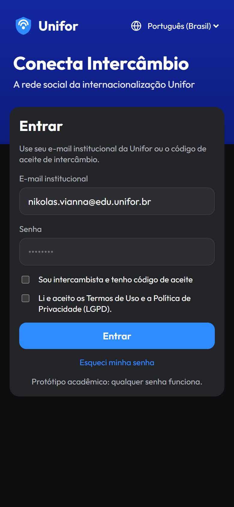 |
| Unifor → Notícias, TV Unifor e filtros | UC06, UC21 | 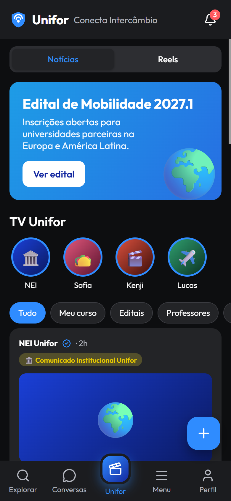 |
| Edital com selo de comunicado institucional (RN01) | UC06 | 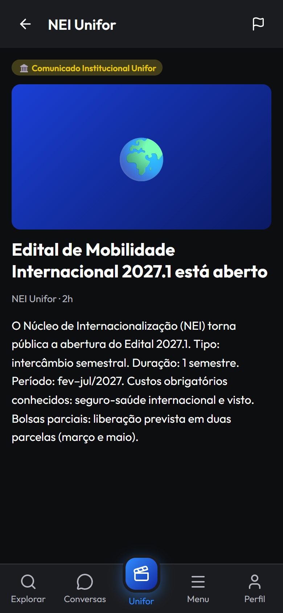 |
| Unifor → Reels | UC22 | 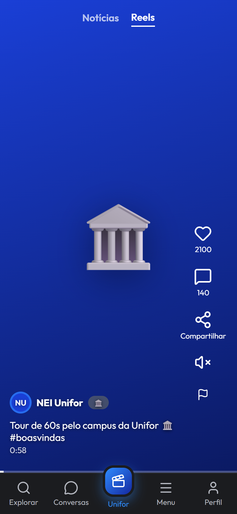 |
| Explorar: categorias, guia da cidade e tópicos em alta | UC18 | 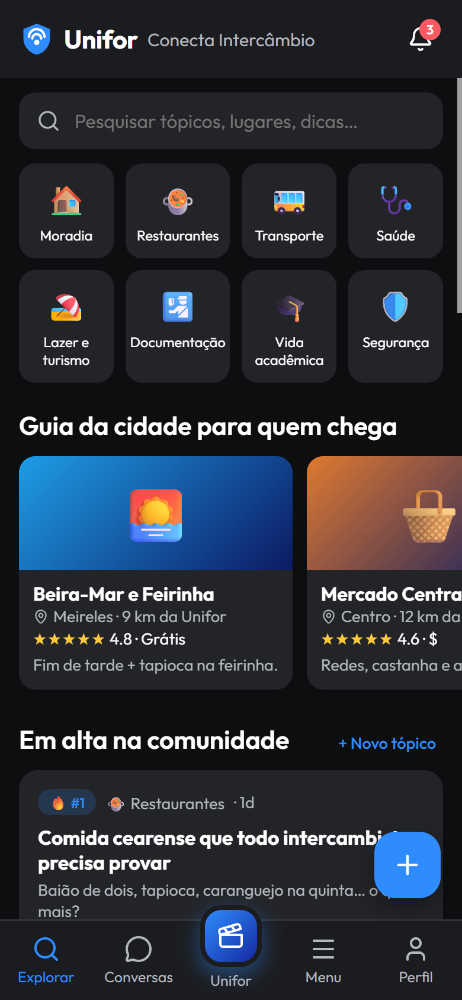 |
| Tópico de moradia com aviso de isenção (RN08) | UC15, UC18 | 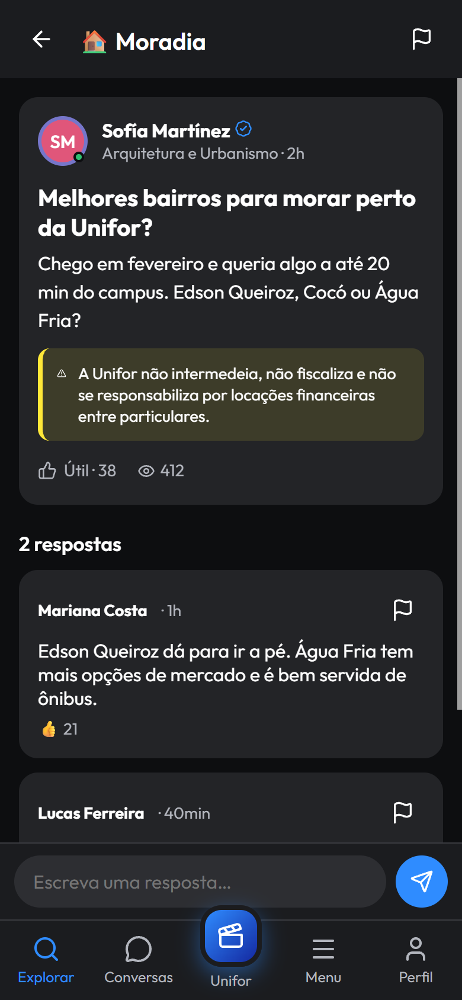 |
| Novo tópico (até 1.000 caracteres) | UC18 | 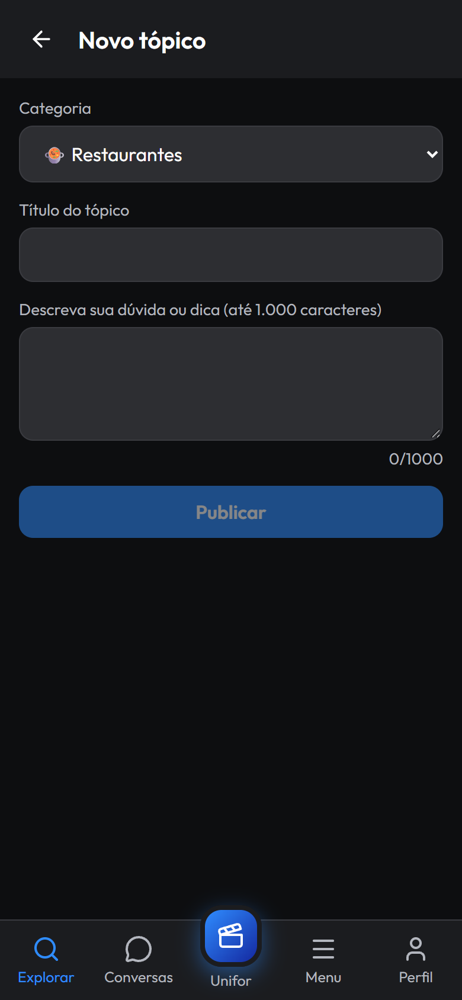 |
| Conversas, grupos e pedidos | UC16 | 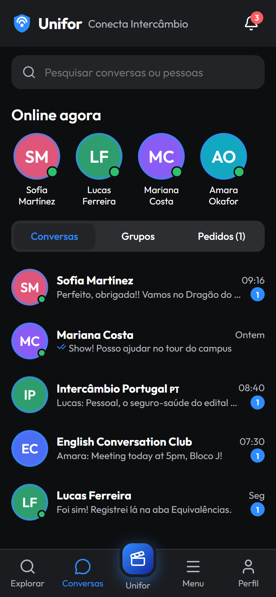 |
| Conversa aberta com aviso de confidencialidade (RN12) | UC16 | 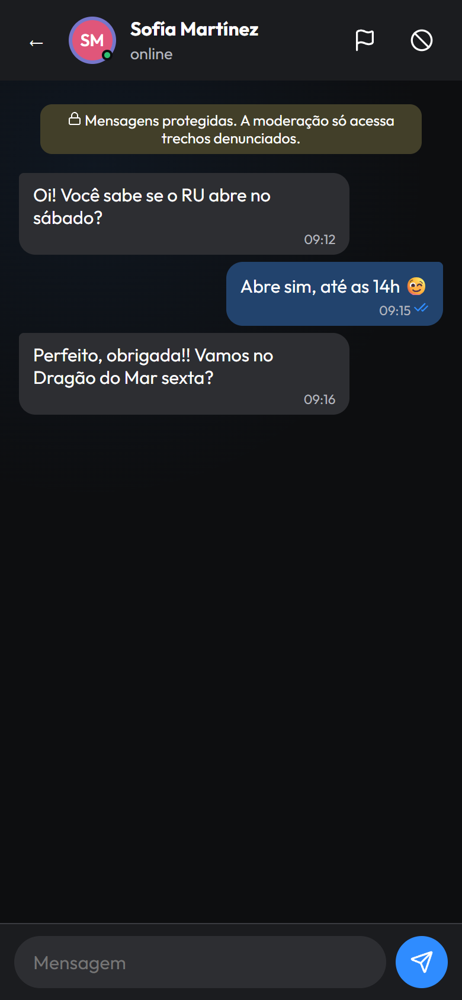 |
| Perfil privado de outra pessoa (RN04) | UC17 | 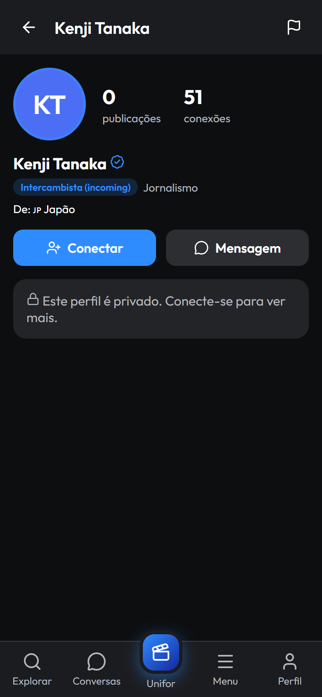 |
| Menu: preferências, comunidade e ajuda | UC19, UC20 | 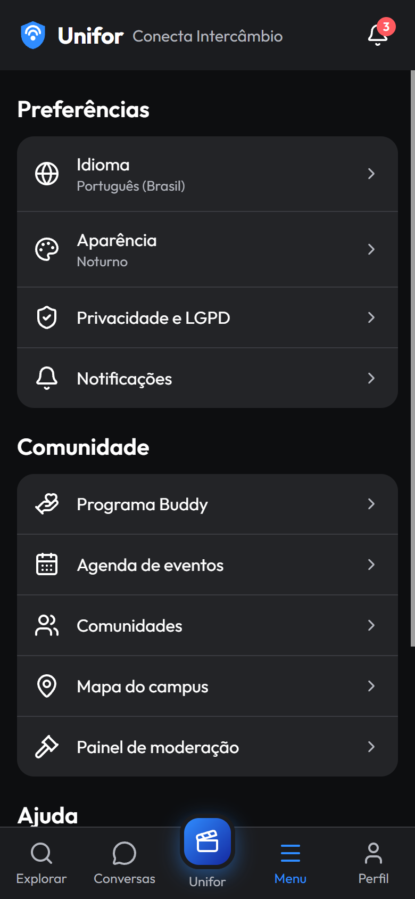 |
| Aparência: modo, cor de destaque e texto | UC19 | 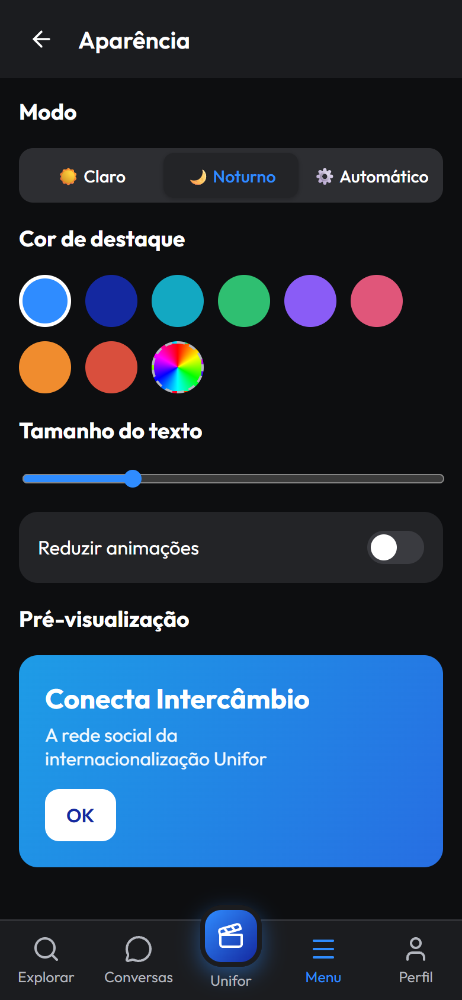 |
| Privacidade e LGPD: visibilidade e consentimentos | UC20 | 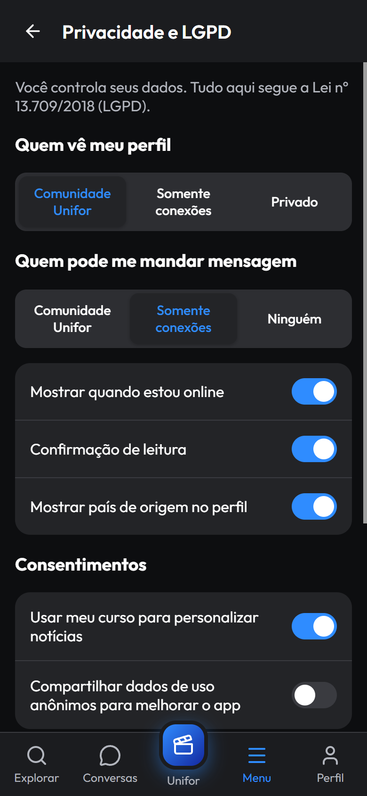 |
| Painel de moderação com denúncias pendentes | UC14 | 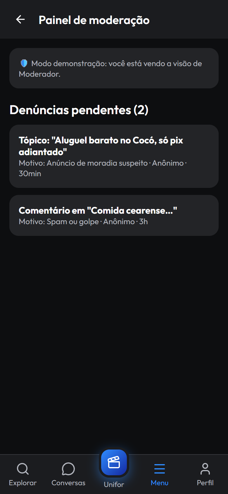 |
| Programa Buddy | UC07 | 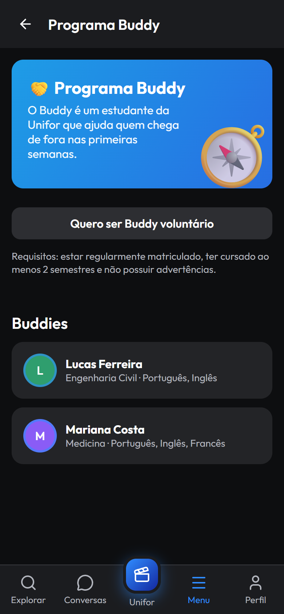 |
| Meu perfil com dados de intercâmbio | UC02, UC21 | 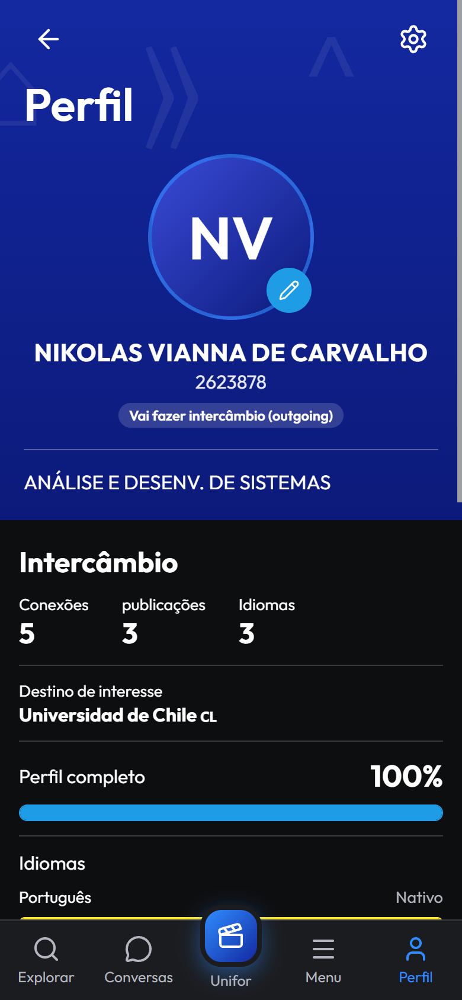 |
